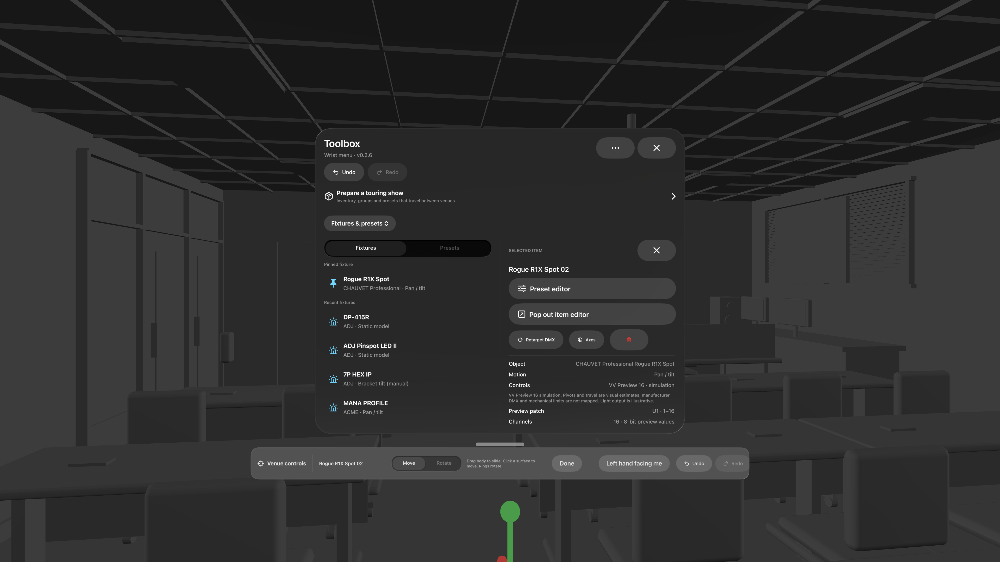
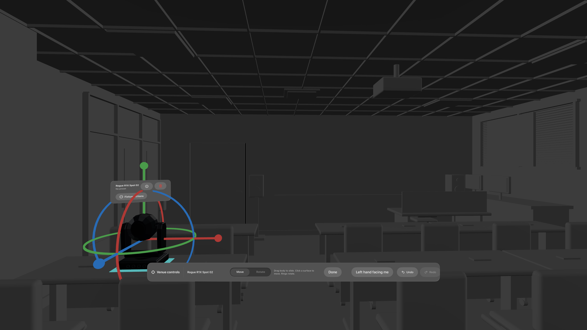
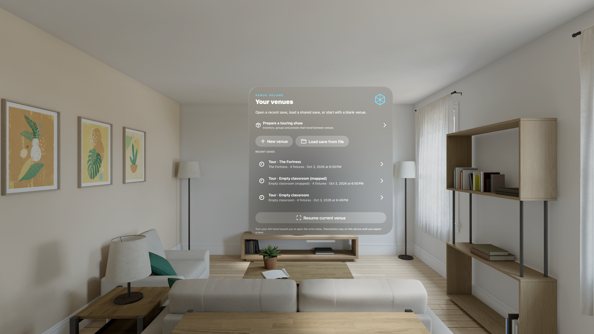

# Fixture movement and bottom venue controls — 2026-10-04

## Source and environment

Task branch: `agent/fixture-placement-ux`, isolated at `.worktree/fixture-placement-ux`, from local `dev` commit `80dee98` (`v0.2.6`). It includes the pending venue-exit fix via cherry-pick `9a65cc0`. The implementation and this report belong to the same task commit. No release integration, version bump, tag, or push was performed. The app still reports bundle version **0.2.6**. `master` and the owner's signing edits in the primary checkout were untouched.

- Xcode **27.0 (27A266a)**; Swift **6.4 (swiftlang-6.4.0.34.1)**.
- visionOS SDK **27.0**.
- Simulator: Apple Vision Pro, visionOS **26.5**, ID `288D6CFE-09D9-422B-96A0-53081DA29C44`.
- Hardware: Chris's Apple Vision Pro, visionOS **27.0.1 (24M372)**, paired over the local network, Developer Mode enabled. Destination `00008112-001619923CC1A01E`.

## Resulting behavior

Click a fixture to select it; click the selected fixture again to enter Move and expose translation axes plus rotation rings. Drag the fixture body to slide on its current plane. Move-mode clicks on other solid room surfaces move the mount to the hit and align the mount's local up direction to the surface normal. Rings rotate the mount independently of DMX Pan/Tilt. Each body drag or surface move is one Undo action. Plane metadata travels with saved fixtures and audit snapshots; older saves without it remain readable. Surface corners, room bounds and scan coverage reject unsupported moves.

The controls now form one wide horizontal glass strip below the user's gaze, continuously following the head. The strip remains present during the venue session and contains contextual Move/Rotate, targeting Save/Cancel, batch-preview actions and Undo/Redo. Simulator additionally exposes its hand-state toggle. Horizontal overflow supports larger text sizes without stacking sections. The old Open/recall wrist button and separate venue-controls window group were removed. Appearance requests the normal movable wrist Toolbox if closed, once rather than repeatedly reopening a deliberately closed window.

The placement library pins Rogue R1X Spot, shows the five most recently selected other models, and provides Browse all for the searchable 252-model catalog. Recent choices persist between normal launches and deduplicate the pilot's catalog alias. Touring inventory uses the same compact model discovery; Browse all inventory and search expose other owned hardware. Pinning does not bypass touring quantities.

Wrist windows are tracked by their UUIDs. Recall closes previous instances before replacement; a late disappearance cannot mark the new window closed. Leaving the venue cancels pending recall and dismisses all tracked wrist windows. The active chooser retries closure after teardown because native validation reproduced ignored dismissal from the disappearing immersive scene. Late-arriving/restored wrist windows close outside immersion. The launch chooser also dismisses on immersion changes, correcting the lingering chooser found during screenshot review.

## Commands and outcomes

Commands were run in `apps/visionos` of the assigned worktree. Logs and native Simulator captures are archived in [evidence/2026-10-04-fixture-movement](evidence/2026-10-04-fixture-movement/).

```sh
swift test --package-path Core
./scripts/test-session.sh
python3 Tests/verify-assets.py

xcodebuild -project VenueVolume.xcodeproj -scheme VenueVolume \
  -configuration Debug \
  -destination 'platform=visionOS Simulator,id=288D6CFE-09D9-422B-96A0-53081DA29C44' \
  -derivedDataPath .build/fixture-ux CODE_SIGNING_ALLOWED=NO build

xcodebuild -project VenueVolume.xcodeproj -scheme VenueVolume \
  -configuration Debug \
  -destination 'platform=visionOS,id=00008112-001619923CC1A01E' \
  -derivedDataPath .build/chris-device DEVELOPMENT_TEAM=3M53U7Y396 build
```

All passed: **91 Core tests**, **10 session check groups**, bundle verification for **252 models** and their rigs, Simulator build and signed device build. The signing team was a command-line override, not a tracked project change.

New focused regression checks cover floor/wall/ceiling mount alignment, normalized quaternions and retained floor heading; plane projection; captured-wall footprint rejection; plane encoding, legacy decoding and invalid normals; second-click activation; no accumulating body-drag drift; atomic Undo/Redo; channel isolation; out-of-bounds rejection; wall sliding; plane persistence; recency order/deduplication/relaunch; duplicate dock appearance; and old/replacement Toolbox callbacks.

```sh
xcrun simctl install 288D6CFE-09D9-422B-96A0-53081DA29C44 \
  '.build/fixture-ux/Build/Products/Debug-xrsimulator/Venue Volume.app'
xcrun simctl launch --terminate-running-process --console-pty \
  288D6CFE-09D9-422B-96A0-53081DA29C44 com.venuevolume.VenueVolume \
  --demo --input-smoke --movement-smoke --palm-hidden \
  -ApplePersistenceIgnoreState YES
```

Native results: `TOOLBOX_WINDOW_SMOKE_PASS`, `SPATIAL_INPUT_SMOKE_PASS`, and `FIXTURE_MOVEMENT_SMOKE_PASS secondClick=true bodySlide=true floorHit=true wallNormal=true undoRedo=true horizontalDock=true`. The movement path calls the renderer's actual tap/drag handlers, uses imported room collision ray hits and checks real input-target components. It validates floor movement and a vertical wall mount, deselection, mount alignment, channel preservation and Undo/Redo. These are native command checks, **not physical hand/gaze gestures**. No failure marker or runtime warning appeared in this final input/window run.

```sh
xcrun simctl launch --terminate-running-process --console-pty \
  288D6CFE-09D9-422B-96A0-53081DA29C44 com.venuevolume.VenueVolume \
  --demo --audit-controls-smoke --movement-smoke --movement-screenshot \
  --palm-hidden -ApplePersistenceIgnoreState YES
xcrun simctl io 288D6CFE-09D9-422B-96A0-53081DA29C44 screenshot \
  docs/validation/evidence/2026-10-04-fixture-movement/move-rings-controls.png
```

Native results: `VENUE_CONTROLS_DOCK_SMOKE_PASS bottomAttachment=true wristReveal=true cancel=true save=true undo=true` and the movement pass above. The presentation flag closes the wrist window and moves the pilot to a real tabletop using the same tap handler, making rings visible in the capture. The first run's screenshot was captured with the same `simctl io ... screenshot` command using `wrist-recents.png`. Recent catalog choices are seeded through model commands only in demo mode; user saves and recency storage are not overwritten.

The controls/target presentation run logged two SwiftUI **unbalanced appearance transition** warnings during rapidly changing RealityView attachments. No smoke failure or AttributeGraph cycle appeared. The warnings remain a native UI diagnostic to review under real interaction; passing model assertions does not resolve them.

```sh
xcrun simctl launch --terminate-running-process --console-pty \
  288D6CFE-09D9-422B-96A0-53081DA29C44 com.venuevolume.VenueVolume \
  --demo --input-smoke --movement-smoke --venue-exit-smoke --palm-hidden \
  -ApplePersistenceIgnoreState YES
xcrun simctl io 288D6CFE-09D9-422B-96A0-53081DA29C44 screenshot \
  docs/validation/evidence/2026-10-04-fixture-movement/venue-exit.png
```

The new native exit regression first reproduced the user's reported failure: after `dismissImmersiveSpace()`, the Toolbox remained rendered behind the chooser and tracked as open. UUID dismissal from the disappearing scene and the Toolbox's state-change callback were insufficient during the transition. After adding cleanup from the active chooser, the final run passed all input/movement markers plus **`VENUE_EXIT_SMOKE_PASS immersed=false toolboxWindows=0 pendingRecall=false`**, with no runtime warning. The screenshot confirms the chooser is the only remaining app window. Both the pre-fix failure and final pass are archived.

```sh
xcrun devicectl device install app --device 00008112-001619923CC1A01E \
  --timeout 45 '.build/chris-device/Build/Products/Debug-xros/Venue Volume.app'
xcrun devicectl device process launch --device 00008112-001619923CC1A01E \
  --timeout 45 --terminate-existing com.venuevolume.VenueVolume
```

**Latest signed build installation passed. Remote normal-mode launch was not confirmed:** CoreDevice exceeded the 45-second timeout. An earlier unbounded launch attempt was stopped after more than two minutes without a response. A subsequent `xcrun devicectl device info lockState --device 00008112-001619923CC1A01E --timeout 15` reported `passcodeRequired: true`; the app was absent from the device process list. No demo or reset arguments were sent to the headset. Existing saves were preserved. Install success is not runtime acceptance.

## Screenshots and review

The wrist capture shows one Toolbox with the pinned pilot and recent-model list; the remaining recent row and Browse all are reachable by scrolling. The chooser no longer remains behind it. The movement capture shows the imported Rogue pilot with X/Y/Z rotation rings and translation axes, alongside the single-row bottom strip. The strip has no recall button.







Review fixes included: correct visual-center placement for rotated/scaled assets; retention of support-plane metadata during ring rotation; preventing simultaneous axis/body transactions; ignoring zero-distance body drags; UUID-specific window dismissal; duplicate appearance suppression; and delayed chooser/wrist restoration cleanup. `git diff --check` passed.

## Remaining acceptance

- **Not tested on a worn headset:** gaze/pinch second click; body-vs-ring gesture arbitration; click-to-wall/ceiling movement; wrist recall/exit; bottom-strip hit testing and comfort during head movement. Launch the installed build manually if CoreDevice launch remains unavailable.
- The requested head-following strip supersedes the previous stationary-controls design. Review whether its peripheral height, apparent size and motion are comfortable during venue work. Large text stays in a horizontal scroller; headset accessibility acceptance remains open.
- Live World Sensing scan, arbitrary scanned wall/ceiling placement, real scan holes, persistence across device relaunch, and hardware performance remain **not tested**. Core synthetic wall coverage and native authored-room wall checks are recorded above; they do not establish live-scan acceptance.
- Initial creation still follows the existing floor/table placement flow. Arbitrary surface-normal alignment is available after selecting Move. All movement is visual simulation; no physical DMX or rigging validation is implied.
- Full-catalog runtime import and two-room performance comparison were not repeated for this focused change. The unchanged asset verifier passed; historical native results remain in their dated reports.
